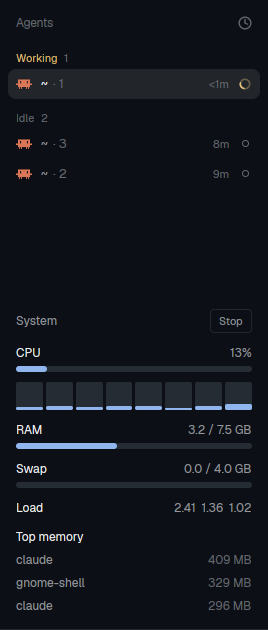

# sysmon: a CPU and RAM monitor for Herdr

A small panel for the [Herdr](https://herdr.dev/) desktop app. It shows how hard your computer
is working while your agents run.



## What it shows

Updated every 2 seconds:

- **CPU:** total use, plus a small bar for each core
- **RAM:** used / total GB
- **Swap:** used / total GB (hidden if you have no swap)
- **Load:** 1, 5 and 15 minute load averages
- **Top memory:** the 3 programs using the most RAM

Bars turn yellow above 60% and red above 85%. Colors follow your Herdr theme.

**Stop / Start:** the button at the top right turns the panel off completely, so it runs no
commands and uses no CPU. Herdr remembers the choice, so a stopped panel stays stopped
after a restart.

If you fold the sidebar narrow, the panel shrinks to just CPU % and RAM %. Click that to stop or start it.

> **Linux only.** It reads `/proc` and uses `cat`, `sh` and `ps`.

## Install

1. Copy the mod into Herdr's folder:
   ```sh
   git clone https://github.com/GabrielL915/Herdr-mod.git
   cp -r Herdr-mod/mods/sysmon ~/.config/herdr-app/mods/
   herdr-app check ~/.config/herdr-app/mods/sysmon
   ```
2. Choose where it appears:

   **Under the Agents list (permanent).** Herdr's built-in `main` layout is read-only, so make
   your own copy of it (this also switches to the copy):
   ```sh
   herdr-app do layout.clone '{"name":"main","as":"my-layout"}'
   ```
   Then open `~/.config/herdr-app/layouts/my-layout.json`, find the block with
   `"id": "sidebar-lists"`, and add this as the last item in its `children` list:
   ```json
   { "id": "sysmon", "type": "block", "size": { "px": 330 }, "min": 60, "content": { "mod": "sysmon" } }
   ```
   Herdr picks up the change right away.

   **Or as a pane in the current tab (one time):**
   ```sh
   herdr-app do pane.split '{"direction":"right","mod":"sysmon"}'
   ```
   Close it with **Ctrl+Shift+X**.

## Notes

- **Cost:** each refresh takes about 18 ms of CPU, around 1% of one core. Press Stop for zero.
- **Layout copies:** a copied layout no longer gets Herdr's updates to `main`.
  **Ctrl+Shift+L** switches between layouts, and **Ctrl+Alt+Shift+Escape** resets to the default.
- **Changing the refresh rate:** edit `EVERY_MS` at the top of `mods/sysmon/main.js`.
- **More detail:** [`RECIPE.md`](RECIPE.md) describes the whole mod, so an agent can rebuild or change it.
