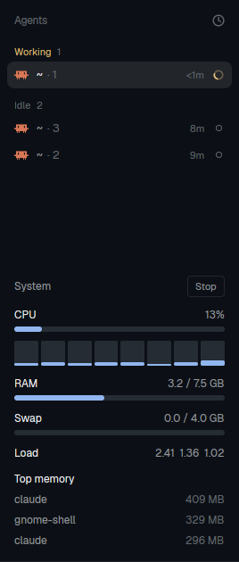

# System Monitor

A small panel that shows how hard your computer is working while your agents run: total CPU,
a mini bar per core, RAM, swap, load average and the three programs using the most memory.
It updates every 2 seconds and has a Stop button that turns it off completely.

**Linux only:** it reads `/proc`.

## What you see

Top to bottom, 16 px side padding, 10 px gaps, 12 px text, in the theme's colors:

- **Header:** "System" in `muted` on the left, and a small outlined **Stop** button on the right
  (11 px, 1 px `border`, 4 px radius, `hover` background). When stopped it reads **Start** in `accent`.
- **CPU:** label on the left, total % on the right, then a 6 px rounded bar.
  Under it, one 28 px tall column per core, filling from the bottom.
- **RAM:** `used / total GB` (used = MemTotal − MemAvailable), then a bar.
- **Swap:** same as RAM. Hidden when the machine has no swap.
- **Load:** the 1, 5 and 15 minute load averages.
- **Top memory:** the 3 processes with the largest RSS, name truncated on the left, `MB` on the right in `dim`.

Bar colors: `accent` below 60%, `ansi3` (yellow) from 60%, `blocked` (red) from 85%.
Bars and core columns slide with a 400 ms width/height transition.

## How it behaves

- Every 2 s it reads `/proc/stat`, `/proc/meminfo`, `/proc/loadavg` and runs
  `ps -eo rss=,comm= --sort=-rss | head -n 3`. CPU % is the change between two readings,
  so the first reading shows "…" for CPU.
- **Stop** cancels the timer: no commands run and no redraws happen until **Start**.
  The choice is kept in the mod's `localStorage` (`paused`), so a stopped panel stays stopped after a restart.
- Narrower than 150 px (a folded sidebar), it shows only CPU % and RAM %. Clicking that toggles Stop/Start.
- A failed read shows the error in `blocked` at the top and tries again on the next tick.

## Built from

- One mod, `mods/sysmon/` (`main.js`, `mod.json` with `{ "place": "right", "size": 240 }`).
- `herdr`: `exec` (local only, no `on`), `theme`. `gpui-kit`: `div`, `cx.timer.every`,
  `Task.cancel`, `cx.spawn`, `.transition`, `.on_size_change`. `gpui-base`: `h_flex`, `v_flex`.
- Programs: `cat`, `sh`, `ps` (procps).
- To put it under the Agents list, clone the main layout (`herdr-app do layout.clone '{"name":"main","as":"my-layout"}'`)
  and add a block as the last child of `sidebar-lists`:
  `{ "id": "sysmon", "type": "block", "size": { "px": 330 }, "min": 60, "content": { "mod": "sysmon" } }`.
  To open it once in the current tab instead: `herdr-app do pane.split '{"direction":"right","mod":"sysmon"}'`.

## Watch out

- `mod.open` shows it as a popup that closes when focus leaves; use a layout block or a pane.
- Shipped layouts are read-only: edit a clone, not `layouts/main.json`.
- Under 330 px tall in the sidebar, "Top memory" is cut off; the panel scrolls.
- Don't animate with the timer: the timer is for data only, and only while running.

## Done when

- `herdr-app check ~/.config/herdr-app/mods/sysmon` passes.
- After a few seconds CPU shows a %, one column per core appears, and RAM matches `free -h`.
- Stop shows "Stopped. Not using any CPU." and no `ps` processes appear from herdr-app; Start brings the numbers back.
- After restarting herdr, a stopped panel is still stopped.
